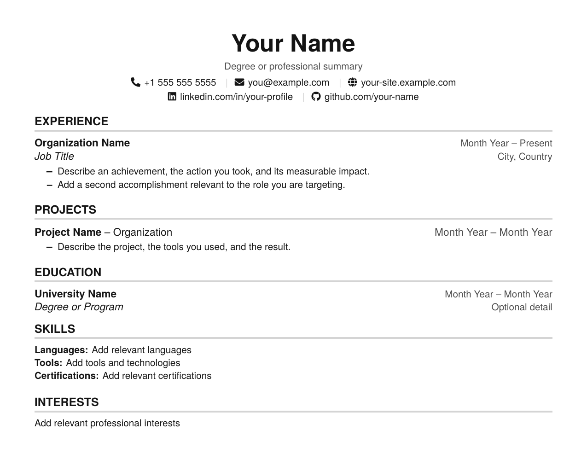

# Resume LaTeX editor

A small local browser editor for drafting the resume in LaTeX and previewing the
compiled PDF. The personal resume source stays on this machine and is excluded
from Git; the generic layout is kept in [`resume-template.tex`](./resume-template.tex).



## Requirements

- Node.js 18 or newer
- MiKTeX or TeX Live, with `pdflatex` available on `PATH`
- The LaTeX packages used by the template (`fontawesome5`, `FiraMono`,
  `tgheros`, `titlesec`, `contour`, and the standard packages in the preamble)

On Windows, install MiKTeX and enable its option to install missing packages
automatically, or install the template packages through MiKTeX Console. Restart
the terminal after installing so `pdflatex` is available on `PATH`.

## Run

```powershell
npm start
```

Or double-click **`Resume Editor.vbs`**: it starts the server without a
command window (if it is not already running) and opens the editor in your
browser. Use the editor's **Stop server** button to shut it down.

Open <http://127.0.0.1:3000>. Pick a document from the dropdown above the
editor, edit the LaTeX in the left pane, then choose **Save draft** or
**Build preview**. A successful build appears in the right pane and can be
downloaded as a PDF.

| Document | File | Starts from |
| --- | --- | --- |
| Resume | `azreen-resume-updated.tex` | `resume-template.tex` |
| Cover letter | `azreen-cover-letter.tex` | `cover-letter-template.tex` |
| Resume template | `resume-template.tex` | |
| Cover letter template | `cover-letter-template.tex` | |

If a personal file does not exist yet, the editor opens its template; saving
creates the personal file. **Import .tex** loads a file from your computer into
the editor for the selected document. Nothing is written until you save.

The personal files and `.resume-preview/` are ignored by Git. Keep personal
details in the ignored files, not in the tracked templates.